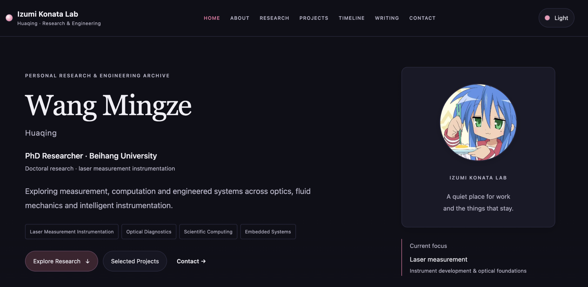
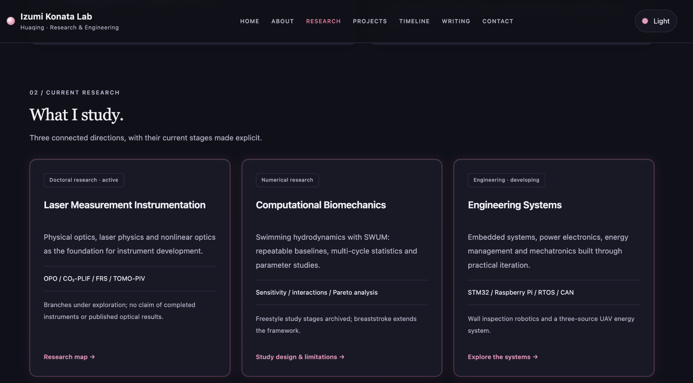
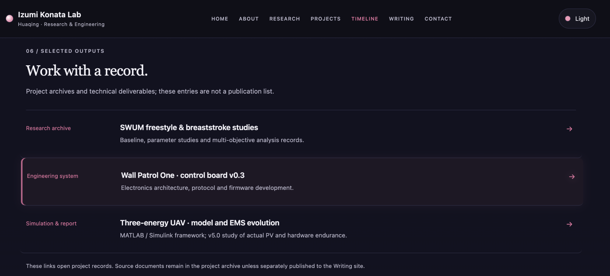
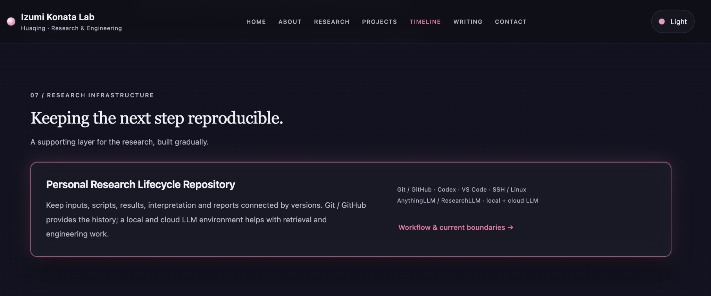
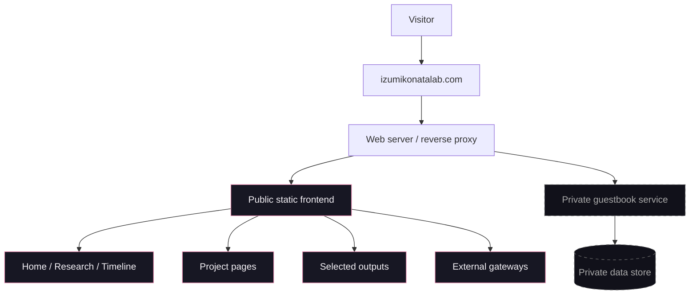

# Izumi Konata Lab

<p align="center">
  <strong>Personal Research & Engineering Archive</strong><br>
  Research · Engineering · Project history · Reproducible workflows
</p>

<p align="center">
  <a href="https://izumikonatalab.com"></a>
  
  
  
</p>

<p align="center">
  <a href="https://izumikonatalab.com"><strong>Visit the live site →</strong></a>
</p>

---

## Preview

<p align="center">
  
</p>

### Research

<p align="center">
  
</p>

### Selected outputs

<p align="center">
  
</p>

### Research infrastructure

<p align="center">
  
</p>

---

## About

**Izumi Konata Lab** is my personal research and engineering website. It serves as a long-term interface for research directions, engineering projects, project evolution, technical outputs, and the infrastructure used to keep that work reproducible.

The site is intentionally lightweight: the public presentation layer is built with **HTML, CSS and vanilla JavaScript**, while production-only services remain separate from this repository.

This repository is **not a server backup**. It is a curated public source snapshot containing the non-sensitive frontend structure, selected project pages, architecture notes, and screenshots used to document the site.

## Featured areas

- **Laser Measurement Instrumentation** — doctoral research direction in optical diagnostics and measurement instrumentation.
- **Computational Biomechanics** — SWUM-based swimming hydrodynamics and multi-cycle numerical studies.
- **Engineering Systems** — embedded systems, electronics, control, energy management and mechatronic integration.
- **Personal Research Infrastructure** — versioned research workflows, project evidence, AI-assisted engineering, and reproducible archiving.

## Architecture



The production backend, authentication, database, reverse-proxy configuration, certificates, and server credentials are intentionally excluded.

More detail: [`docs/architecture.md`](docs/architecture.md)

## Repository structure

```text
izumi-konata-lab/
├── README.md
├── CHANGELOG.md
├── LICENSE
├── NOTICE.md
├── .gitignore
├── docs/
│   ├── architecture.md
│   └── screenshots/
│       ├── 01-home.png
│       ├── 02-research.png
│       ├── 03-selected-outputs.png
│       └── 04-infrastructure.png
└── src/
    ├── index.html
    ├── assets/
    │   ├── css/
    │   │   └── style.css
    │   └── js/
    │       └── main.js
    └── projects/
        ├── wall-patrol-one/
        ├── swum/
        ├── three-energy-uav/
        ├── laser-measurement/
        └── research-infrastructure/
```

## Public repository scope

| Included | Intentionally excluded |
|---|---|
| Public HTML structure | Guestbook backend implementation |
| CSS and client-side JavaScript | Database files and message data |
| Five project pages | Authentication and credentials |
| Architecture documentation | Production reverse-proxy configuration |
| Four selected screenshots | TLS/SSL material and server secrets |
| Public links and content | Private/personal source assets |

The following visual assets used by the production site are **not distributed here**: avatar, favicon, Sakana resources, wind-chime asset, and dedication image. References may remain in the frontend source to preserve the production structure, but the files themselves are deliberately omitted.

## Design principles

- **Preservation over rebuild** — long-lived interactions and site identity evolve incrementally.
- **Low operational complexity** — static frontend first; production services remain isolated.
- **Readable hierarchy** — research, projects, timeline and outputs are separated by intent.
- **Quiet visual language** — restrained typography, dark/light modes and subtle pink micro-glow interactions.
- **Traceable evolution** — project pages emphasize versions, boundaries and current status rather than only final results.

## Project pages

| Project | Focus |
|---|---|
| Wall Patrol One | Magnetic wall-inspection robotic platform and embedded control stack |
| SWUM Swimming Research | Computational biomechanics and swimming hydrodynamics |
| Three-Energy UAV | Solar / Li-ion / hydrogen fuel-cell energy system and EMS evolution |
| Laser Measurement | Doctoral research direction in optical measurement instrumentation |
| Research Infrastructure | Research lifecycle, versioning and reproducible workflow architecture |

## Production boundary

This repository intentionally stops at the public presentation layer. The live system contains additional private components that are not required to understand the frontend architecture and should not be reproduced from this repository.

If you are browsing the source to study the implementation, start with:

- [`src/index.html`](src/index.html)
- [`src/assets/css/style.css`](src/assets/css/style.css)
- [`src/assets/js/main.js`](src/assets/js/main.js)
- [`docs/architecture.md`](docs/architecture.md)

## Version

Public snapshot aligned with the **Izumi Konata Lab v2.0.x** redesign, including the refined card micro-glow and Hikari dedication interaction styling.

## License

Source code in `src/` is released under the MIT License. See [`NOTICE.md`](NOTICE.md) for exclusions covering screenshots, branding, personal content, research content, and omitted private assets.

---

<p align="center">
  <strong>Build. Measure. Iterate.</strong><br>
  <sub>Izumi Konata Lab · Huaqing</sub>
</p>
