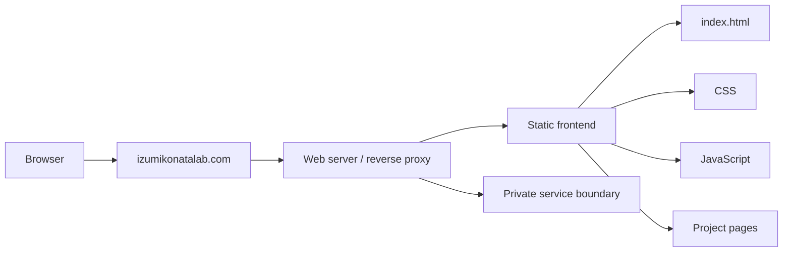

# Architecture

## Purpose

This document describes the **public architectural boundary** of Izumi Konata Lab. It intentionally omits operational secrets, production credentials, database contents, private backend implementation details, and server-specific configuration.

## Public request path



The public site uses a static-first architecture. The homepage and project pages are served as static HTML/CSS/JavaScript. Interactive production services are isolated behind the web-server boundary and are not included in this repository.

## Frontend layout

```text
src/
├── index.html
├── assets/
│   ├── css/style.css
│   └── js/main.js
└── projects/
    ├── wall-patrol-one/index.html
    ├── swum/index.html
    ├── three-energy-uav/index.html
    ├── laser-measurement/index.html
    └── research-infrastructure/index.html
```

## Design boundary

The production site contains visual/personality assets that are intentionally absent from the public repository. These include the avatar, favicon, Sakana assets, wind-chime asset and dedication image. Their omission is deliberate and does not imply that the production site lacks them.

## Private production components

The following are intentionally not documented at implementation level:

- authentication material;
- message/database contents;
- private backend source;
- reverse-proxy production configuration;
- TLS/SSL keys and certificates;
- SSH credentials;
- environment variables, API keys or tokens;
- private/personal source images.

The repository is therefore suitable as a **public architecture and frontend showcase**, not as a drop-in production clone.
